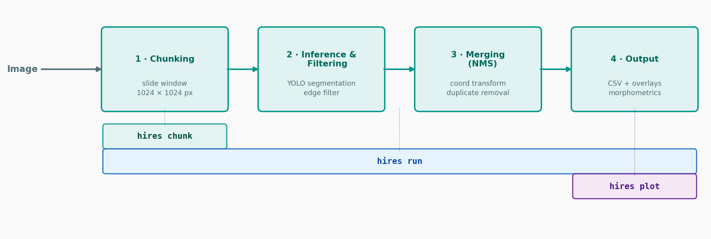

# HiReS

**Tiled instance segmentation and morphometric analysis of high-resolution images**

[](https://pypi.org/project/hireseg/)
[](https://pypi.org/project/hireseg/)
[](https://github.com/StevetheGreek97/HiReS/actions/workflows/ci.yml)
[](https://stevethegreek97.github.io/HiReS/)
[](https://github.com/StevetheGreek97/HiReS/blob/main/LICENSE)

HiReS (*High-Resolution Segmentation*) is a Python library and command-line
tool for images that are too large for a single neural-network pass. It cuts
a scan into overlapping tiles, runs a YOLO segmentation model on each tile,
stitches the detections back into polygons in full-image coordinates,
measures the shape of every object, and evaluates the result against ground
truth.

```python
import hires

collection = hires.segment("scan.tif", "DaphnAI.pt")
collection.with_scale(dpi=2400, unit="um").to_csv("traits.csv")
```

**Documentation: <https://stevethegreek97.github.io/HiReS/>**



## Features

- **Tiled segmentation** of arbitrarily large images on a laptop CPU or a
  single GPU. Objects cut by a tile border are recovered from the
  neighbouring tile; duplicates are removed with polygon NMS.
- **A small, immutable data model**: `Annotation` (one polygon),
  `Collection` (one image) and `Album` (one dataset).
- **Morphometric traits**: area, perimeter, solidity, convexity,
  circularity and bounding-box dimensions, in pixels or physical units.
- **Evaluation against ground truth**: IoU matching, precision, recall, F1,
  average precision, confusion matrices and per-object comparison figures.
- **Model-agnostic**: any Ultralytics YOLO segmentation model, or any object
  with a compatible `predict()` method. YOLO is an optional dependency;
  reading, measuring and evaluating label files needs no deep-learning
  stack.

## Installation

```bash
pip install "hireseg[yolo]"     # with Ultralytics YOLO, to run models
pip install hireseg             # core only: read, measure, evaluate, plot
```

The distribution is called `hireseg`; the import name is `hires`. Python
3.10 or newer is required. For GPU inference, install PyTorch for your CUDA
version first, following <https://pytorch.org/get-started/locally/>.

## Quick start

### Python

```python
import hires

# Segment one image
collection = hires.segment("scan.tif", "DaphnAI.pt", overlap=300, device="cpu")
print(collection.class_counts())

# Measure in micrometres and export
scaled = collection.with_scale(dpi=2400, unit="um")
scaled.filter_area(min_area=5e4).to_csv("scan_shapes.csv")

# Look at the result
hires.plot.overlay("scan.tif", collection, save="scan_annotated.png")

# Process a directory and write labels, tables and overlays
album = hires.run_pipeline("scans/", "DaphnAI.pt", "results/", dpi=2400, unit="um")

# Evaluate against manual annotations
gt = hires.read_album("labels/", image_dir="scans/")
pred = hires.read_album("results/", image_dir="scans/")
report = hires.evaluate(gt, pred, "evaluation/")
```

### Command line

```bash
hires run -s scans/ -m DaphnAI.pt -o results/ --dpi 2400 --unit um
hires evaluate --gt labels/ --pred results/ --images scans/
hires plot -s scans/ --ann labels/ -o plots/ -m data.yaml
hires chunk -s scans/ -o chunks/
```

| Command | Purpose |
|---------|---------|
| `hires run` | Segment images and write labels, trait tables and overlays |
| `hires evaluate` | Compare predictions with ground truth |
| `hires plot` | Draw existing label files on their images |
| `hires chunk` | Cut images into overlapping tiles |

Run `hires <command> --help` for all options.

## Outputs of `hires run`

| File | Content |
|------|---------|
| `<image>.txt` | Detections as YOLO segmentation labels with confidences |
| `<image>_shapes.csv` | One row per detection with its morphometric traits |
| `<image>_annotated.tif` | The image with the detections drawn on top |
| `<image>_crops/` | One masked crop per detection (`--save-crops`) |
| `run_config.yaml` | The settings of the run |

## Package layout

| Namespace | Contents |
|-----------|----------|
| `hires` | Data model, readers, `segment`, `run_pipeline`, `measure`, `evaluate` |
| `hires.metrics` | Matching predictions to ground truth and detection metrics |
| `hires.plot` | Overlays, comparison images and evaluation charts |
| `hires.tiling` | Splitting images and labels into tiles and merging them back |

## Upgrading from 1.x

Version 2.0 is a rewrite of the Python API; the command line is largely
unchanged. See the
[migration guide](https://stevethegreek97.github.io/HiReS/getting-started/migration.html)
and the [changelog](https://github.com/StevetheGreek97/HiReS/blob/main/CHANGELOG.md).

## Contributing

Bug reports and pull requests are welcome; see [CONTRIBUTING.md](https://github.com/StevetheGreek97/HiReS/blob/main/CONTRIBUTING.md).

## Citing

If you use HiReS in your research, please cite:

> Mavrianos S., Teurlincx S., Declerck S.A.J., Otte K.A. (2025). *HiReS: A
> Method for Automated Morphometric Trait Extraction from High-Resolution
> Plankton Images.*

Citation metadata is in [CITATION.cff](https://github.com/StevetheGreek97/HiReS/blob/main/CITATION.cff).

## License

[MIT](https://github.com/StevetheGreek97/HiReS/blob/main/LICENSE) © Stylianos Mavrianos
