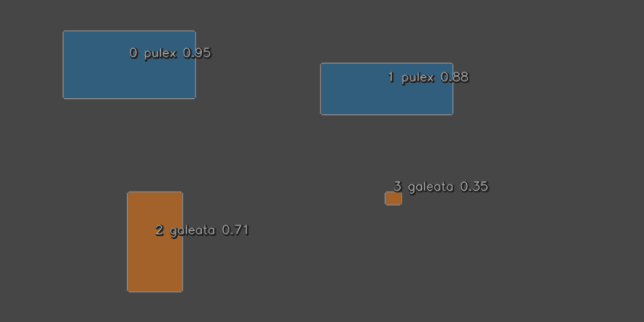

# Quickstart

This page is a short, hands-on tour of HiReS. Every example shows the
commands as you would type them at the Python prompt (`>>>`) followed by
what they print, and can be pasted into a Python session as it is.

```python
>>> import hires
```

## Segment an image

With a high-resolution image and YOLO segmentation weights,
[`hires.segment`][hires.segment] does the whole job: it cuts the image into
overlapping tiles, runs the model on each tile, and merges the detections.
This step needs the `yolo` extra (see [Installation](installation.md)).

```python
>>> collection = hires.segment("scan.tif", "DaphnAI.pt")  # doctest: +SKIP
```

The result is a [`Collection`][hires.Collection]: the detected objects of
one image. The same object is returned when you read a label file, which is
what the rest of this page does, so that **you can follow along without a
model or an image**.

## A collection without a model

HiReS stores detections in YOLO segmentation label files: one line per
object, holding the class id, the polygon as `x y` pairs, and the
confidence. Let us write a small one by hand, with four objects:

```python
>>> from pathlib import Path
>>> labels = """\
... 0 0.10 0.10 0.30 0.10 0.30 0.30 0.10 0.30 0.95
... 0 0.50 0.20 0.70 0.20 0.70 0.35 0.50 0.35 0.88
... 1 0.20 0.60 0.28 0.60 0.28 0.90 0.20 0.90 0.71
... 1 0.60 0.60 0.62 0.60 0.62 0.63 0.60 0.63 0.35
... """
>>> _ = Path("scan.txt").write_text(labels)
```

and read it back. The coordinates in the file are fractions of the image
width and height, so we also say how large the image is, as
`(width, height)` in pixels:

```python
>>> collection = hires.read_txt("scan.txt", image_size=(800, 400))
>>> collection
Collection(name='scan', n=4, image_size=(800, 400))
```

A collection behaves like a list of [`Annotation`][hires.Annotation]
objects:

```python
>>> len(collection)
4
>>> collection[0]
Annotation(class_id=0, confidence=0.950, vertices=4)
>>> collection.class_counts()
{0: 2, 1: 2}
```

## Measure

[`to_frame`][hires.Collection.to_frame] returns a `pandas.DataFrame` with
one row per object and one column per morphometric trait:

```python
>>> traits = collection.to_frame()
>>> traits[["class_id", "confidence", "area", "obb_length", "obb_width"]]
   class_id  confidence     area  obb_length  obb_width
0         0        0.95  12800.0       160.0       80.0
1         0        0.88   9600.0       160.0       60.0
2         1        0.71   7680.0       120.0       64.0
3         1        0.35    192.0        16.0       12.0
```

The values are in pixels, because the collection knows its image size but
not the physical size of a pixel. Attach the scan resolution to measure in
physical units instead:

```python
>>> scaled = collection.with_scale(dpi=2400, unit="um")
>>> scaled.to_frame()[["class_id", "area", "obb_length", "obb_width"]].round(1)
   class_id       area  obb_length  obb_width
0         0  1433688.9      1693.3      846.7
1         0  1075266.7      1693.3      635.0
2         1   860213.3      1270.0      677.3
3         1    21505.3       169.3      127.0
```

Note that `with_scale` did not change `collection`. Collections are
immutable: every method returns a new one.

All nine traits are defined in
[Morphometric traits](../user-guide/morphometrics.md).

## Filter

Methods can be chained. Here we keep confident detections, drop everything
smaller than 10⁵ µm², and count what is left:

```python
>>> animals = scaled.filter_confidence(0.5).filter_area(min_area=1e5)
>>> animals
Collection(name='scan', n=3, image_size=(800, 400), dpi=2400, unit='um')
>>> animals.class_counts()
{0: 2, 1: 1}
```

More in [Filtering and class handling](../user-guide/filtering.md).

## Save

```python
>>> animals.to_csv("animals.csv")
>>> animals.to_txt("animals.txt")
>>> print(Path("animals.txt").read_text())
0 0.100000 0.100000 0.300000 0.100000 0.300000 0.300000 0.100000 0.300000 0.950000
0 0.500000 0.200000 0.700000 0.200000 0.700000 0.350000 0.500000 0.350000 0.880000
1 0.200000 0.600000 0.280000 0.600000 0.280000 0.900000 0.200000 0.900000 0.710000
```

## Plot

[`hires.plot.overlay`][hires.plot.overlay] draws a collection on its image.
We have no image here, so we draw on an empty grey canvas of the right size:

```python
>>> import numpy as np
>>> canvas = np.full((400, 800, 3), 70, dtype=np.uint8)
>>> rgb = hires.plot.overlay(
...     canvas, collection, class_names={0: "pulex", 1: "galeata"},
...     save="quickstart_overlay.png",
... )
>>> rgb.shape
(400, 800, 3)
```



The number in front of each label is the position of the object in the
collection: the object labelled `2` is `collection[2]`. With a real scan,
pass its path instead of `canvas`.

## Evaluate against ground truth

Suppose a person annotated the same image and found three objects. Ground
truth has no confidence, so each line ends after the last coordinate:

```python
>>> manual = """\
... 0 0.10 0.10 0.30 0.10 0.30 0.30 0.10 0.30
... 0 0.50 0.20 0.70 0.20 0.70 0.36 0.50 0.36
... 0 0.20 0.60 0.28 0.60 0.28 0.90 0.20 0.90
... """
>>> _ = Path("scan_gt.txt").write_text(manual)
>>> gt = hires.read_txt("scan_gt.txt", image_size=(800, 400))
```

[`hires.metrics.match`][hires.metrics.match] pairs each prediction with the
ground-truth object it overlaps. The ground truth always comes first:

```python
>>> matches = hires.metrics.match(gt, collection)
>>> matches.counts()
{'tp': 2, 'misclassified': 1, 'fp': 1, 'fn': 0}
```

Two objects were found with the right class (`tp`), one was found but given
the wrong class (`misclassified`), and one prediction has no counterpart
(`fp`). The table behind these numbers:

```python
>>> matches.to_frame()[["status", "iou", "gt_class", "pred_class", "pred_confidence"]]
          status     iou  gt_class  pred_class  pred_confidence
0             tp  1.0000         0           0             0.95
1  misclassified  1.0000         0           1             0.71
2             tp  0.9375         0           0             0.88
3             fp  0.0000      <NA>           1             0.35
```

and the usual summary metrics per class:

```python
>>> report = hires.metrics.detection_report(gt, collection)
>>> report[["tp", "fp", "fn", "precision", "recall", "f1"]].round(2)
          tp  fp  fn  precision  recall    f1
class_id
all        2   2   1        0.5    0.67  0.57
0          2   0   1        1.0    0.67  0.80
1          0   2   0        0.0    0.00  0.00
```

[Evaluation](../user-guide/evaluation.md) explains the matching and every
metric.

## Whole directories, and the command line

For a directory of scans, [`hires.run_pipeline`][hires.run_pipeline]
segments every image and writes labels, trait tables and overlays;
[`hires.read_album`][hires.read_album] reads a directory of label files
back as an [`Album`][hires.Album], a named set of collections; and
[`hires.evaluate`][hires.evaluate] writes a complete evaluation report.

```python
>>> album = hires.run_pipeline(  # doctest: +SKIP
...     "scans/", "DaphnAI.pt", "results/", dpi=2400, unit="um"
... )
>>> gt = hires.read_album("labels/", image_dir="scans/")  # doctest: +SKIP
>>> report = hires.evaluate(gt, album, "evaluation/")  # doctest: +SKIP
```

The same three steps from a terminal:

```bash
hires run -s scans/ -m DaphnAI.pt -o results/ --dpi 2400 --unit um
hires evaluate --gt labels/ --pred results/ --images scans/ -o evaluation/
```

The files this produces are listed in
[Output files](../reference/outputs.md).

## Where to go next

| To learn about | Read |
|----------------|------|
| `Annotation`, `Collection` and `Album` | [The data model](../user-guide/data-model.md) |
| Label files, tables and crops | [Reading and writing](../user-guide/io.md) |
| How tiling works and how to tune it | [Tiled segmentation](../user-guide/segmentation.md) |
| What each trait means | [Morphometric traits](../user-guide/morphometrics.md) |
| Precision, recall, AP and friends | [Evaluation](../user-guide/evaluation.md) |
| Every function and its parameters | [API reference](../reference/index.md) |
