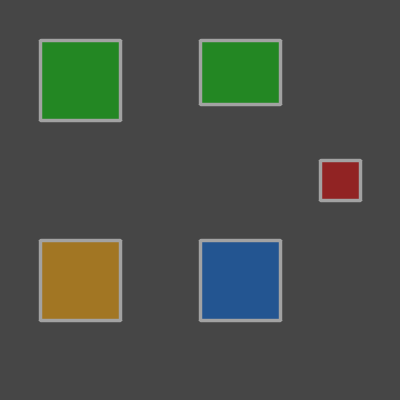

# Evaluation

How good are the predictions? HiReS answers this by pairing every predicted
polygon with a ground-truth polygon and counting what is left over. This
page explains the pairing, defines every metric derived from it, and shows
how to inspect individual objects.

All functions live in [`hires.metrics`](../reference/metrics.md) and take
the **ground truth first** and the **predictions second**.

## The example

The examples use one small image with four ground-truth objects, two of
class 0 (top row) and two of class 1 (bottom row), and four predictions
that contain every kind of mistake:

```python
>>> from shapely.geometry import box
>>> import hires
>>> gt = hires.Collection(
...     [
...         hires.Annotation(0, box(0.10, 0.10, 0.30, 0.30)),
...         hires.Annotation(0, box(0.50, 0.10, 0.70, 0.30)),
...         hires.Annotation(1, box(0.10, 0.60, 0.30, 0.80)),
...         hires.Annotation(1, box(0.50, 0.60, 0.70, 0.80)),
...     ],
...     name="scan",
...     image_size=(400, 400),
... )
>>> pred = hires.Collection(
...     [
...         hires.Annotation(0, box(0.10, 0.10, 0.30, 0.30), confidence=0.95),  # exact
...         hires.Annotation(0, box(0.50, 0.10, 0.70, 0.26), confidence=0.80),  # too small
...         hires.Annotation(0, box(0.10, 0.60, 0.30, 0.80), confidence=0.70),  # wrong class
...         hires.Annotation(1, box(0.80, 0.40, 0.90, 0.50), confidence=0.40),  # not an object
...     ],
...     name="scan",
...     image_size=(400, 400),
... )
```

The fourth ground-truth object has no prediction at all. Drawn on an empty
canvas with [`hires.plot.comparison`](plotting.md#predictions-versus-ground-truth),
the situation looks like this (green: correct, orange: wrong class, red:
false positive, blue: missed):

```python
>>> import numpy as np
>>> canvas = np.full((400, 400, 3), 70, dtype=np.uint8)
>>> _ = hires.plot.comparison(
...     canvas, hires.metrics.match(gt, pred), save="evaluation_comparison.png"
... )
```

{ width="360" }

## Matching

[`hires.metrics.match`][hires.metrics.match] pairs polygons by
intersection-over-union,

$$
\text{IoU}(A, B) = \frac{|A \cap B|}{|A \cup B|},
$$

computed on the polygons themselves, not on their bounding boxes:

```python
>>> round(hires.metrics.iou(gt[1], pred[1]), 2)
0.8
>>> hires.metrics.iou_matrix(gt, pred).round(2)
array([[1. , 0. , 0. , 0. ],
       [0. , 0.8, 0. , 0. ],
       [0. , 0. , 1. , 0. ],
       [0. , 0. , 0. , 0. ]])
```

The matrix has one row per ground-truth object and one column per
prediction. Matching then proceeds in three steps:

1. All pairs with $\text{IoU} \ge t$ are candidates. The threshold $t$ is
   `iou_threshold`, `0.5` by default.
2. Candidates are accepted greedily in order of decreasing IoU. Once an
   object is part of a match it is not available again, so the matching is
   one-to-one.
3. Whatever remains unmatched becomes a false negative (ground truth) or a
   false positive (prediction).

```python
>>> matches = hires.metrics.match(gt, pred)
>>> matches
MatchResult(iou_threshold=0.5, tp=2, misclassified=1, fp=1, fn=1)
>>> matches.counts()
{'tp': 2, 'misclassified': 1, 'fp': 1, 'fn': 1}
```

Every object ends up in exactly one [`Match`][hires.metrics.Match] with one
of four statuses:

| Status | Ground truth | Prediction | Meaning |
|--------|:------------:|:----------:|---------|
| `tp` | ✓ | ✓ | Found, with the right class |
| `misclassified` | ✓ | ✓ | Found, with the wrong class |
| `fp` | – | ✓ | A prediction where there is no object |
| `fn` | ✓ | – | An object the model missed |

```python
>>> for m in matches:
...     print(f"{m.status:14} iou={m.iou:.2f}  gt={m.gt_index}  pred={m.pred_index}")
tp             iou=1.00  gt=0  pred=0
misclassified  iou=1.00  gt=2  pred=2
tp             iou=0.80  gt=1  pred=1
fn             iou=0.00  gt=3  pred=None
fp             iou=0.00  gt=None  pred=3
```

### The IoU threshold

A stricter threshold demands better outlines. At `0.9` the prediction that
is too small no longer counts as a match, and turns into one missed object
plus one false positive:

```python
>>> hires.metrics.match(gt, pred, iou_threshold=0.9).counts()
{'tp': 1, 'misclassified': 1, 'fp': 2, 'fn': 2}
```

| `iou_threshold` | Asks |
|-----------------|------|
| `0.5` | Was the object found? The conventional default. |
| `0.7`–`0.8` | Is the outline good enough to measure? Use this when the downstream analysis is morphometric. |
| `0.9` and above | Rarely meaningful: two careful human annotators often agree less than that on small objects. |

### Class-agnostic and class-aware matching

By default, matching ignores the class: an object that was outlined
correctly but labelled wrongly is one `misclassified` match. This separates
*localisation* errors from *classification* errors.

With `class_aware=True` only polygons of the same class may match, so the
same object yields one `fn` and one `fp`:

```python
>>> hires.metrics.match(gt, pred, class_aware=True).counts()
{'tp': 2, 'misclassified': 0, 'fp': 2, 'fn': 2}
```

The metrics below are the same either way; only the bookkeeping differs.

## Working with the result

`match` returns a [`MatchResult`][hires.metrics.MatchResult], an immutable
sequence of matches that can be indexed, filtered and tabulated:

```python
>>> first = matches[0]
>>> first.status, first.iou, first.gt.class_id, first.pred.confidence
('tp', 1.0, 0, 0.95)
>>> matches.with_status("fp", "fn")
MatchResult(iou_threshold=0.5, tp=0, misclassified=0, fp=1, fn=1)
>>> matches.filter(lambda m: m.iou > 0.9)
MatchResult(iou_threshold=0.5, tp=1, misclassified=1, fp=0, fn=0)
```

`summary` returns the overall numbers as a dict:

```python
>>> summary = matches.summary()
>>> summary["n_gt"], summary["n_pred"]
(4, 4)
>>> round(summary["precision"], 2), round(summary["recall"], 2), round(summary["f1"], 2)
(0.5, 0.5, 0.5)
>>> round(summary["mean_iou"], 2)
0.93
```

[`to_frame`][hires.metrics.MatchResult.to_frame] gives one row per match.
Row `i` describes `matches[i]`; fields of a missing object are empty:

```python
>>> names = {0: "pulex", 1: "galeata"}
>>> table = matches.to_frame(class_names=names)
>>> table[["status", "iou", "gt_class_name", "pred_class_name", "pred_confidence"]]
          status  iou gt_class_name pred_class_name  pred_confidence
0             tp  1.0         pulex           pulex             0.95
1  misclassified  1.0       galeata           pulex             0.70
2             tp  0.8         pulex           pulex             0.80
3             fn  0.0       galeata            None              NaN
4             fp  0.0          None         galeata             0.40
```

The table also holds the nine traits of both objects, as `gt_*` and
`pred_*` columns:

```python
>>> table[["status", "gt_area", "pred_area"]]
          status  gt_area  pred_area
0             tp   6400.0     6400.0
1  misclassified   6400.0     6400.0
2             tp   6400.0     5120.0
3             fn   6400.0        NaN
4             fp      NaN     1600.0
```

## Metrics

### Precision, recall and F1

$$
P = \frac{TP}{TP + FP}, \qquad
R = \frac{TP}{TP + FN}, \qquad
F_1 = \frac{2PR}{P + R}
$$

Precision is the fraction of predictions that are correct; recall is the
fraction of objects that were found; F1 is their harmonic mean. A metric
whose denominator is zero is reported as `0.0`.

A `misclassified` pair is **both** an error of the ground-truth class,
which lost an object (FN), and of the predicted class, which gained a wrong
one (FP).

### The detection report

```python
>>> report = hires.metrics.detection_report(gt, pred, class_names=names)
>>> report[["class_name", "tp", "fp", "fn", "precision", "recall", "f1"]].round(2)
         class_name  tp  fp  fn  precision  recall   f1
class_id
all             all   2   2   2       0.50     0.5  0.5
0             pulex   2   1   0       0.67     1.0  0.8
1           galeata   0   1   2       0.00     0.0  0.0
>>> report[["class_name", "ap50", "ap50_95"]].round(2)
         class_name  ap50  ap50_95
class_id
all             all   0.5     0.42
0             pulex   1.0     0.85
1           galeata   0.0     0.00
```

Reading the row of class 0: two of its objects were found (`tp`); a third
prediction of class 0 is really a class 1 object (`fp`); nothing of class 0
was missed (`fn`). Class 1 has no correct prediction at all.

| Column | Content |
|--------|---------|
| `tp`, `fp`, `fn` | Counts at `iou_threshold` |
| `precision`, `recall`, `f1` | Derived from the counts |
| `ap50` | Average precision at IoU 0.5 |
| `ap50_95` | Average precision, averaged over IoU 0.50, 0.55, …, 0.95 |

In the `"all"` row the counts are summed over the classes and precision,
recall and F1 are computed from the sums (a *micro* average, dominated by
frequent classes), while `ap50` and `ap50_95` are the unweighted mean over
classes (mAP, a *macro* average).

### Average precision

Precision and recall describe the model at one confidence threshold.
Average precision (AP) summarises all thresholds: the predictions of a
class are ranked by confidence, precision and recall are computed for every
prefix of the ranking, and AP is the area under the resulting
precision-recall curve, using all-point interpolation.

```python
>>> hires.metrics.average_precision(gt, pred, iou_threshold=0.5).round(2)
class_id
0    1.0
1    0.0
Name: ap@0.5, dtype: float64
>>> hires.metrics.average_precision(gt, pred, iou_threshold=0.9).round(2)
class_id
0    0.5
1    0.0
Name: ap@0.9, dtype: float64
```

`ap50_95` repeats this for ten IoU thresholds and averages, which rewards
accurate outlines, not only found objects.

!!! note "Difference from COCO"

    HiReS matches polygons once, greedily by IoU and independently of
    confidence, and ranks afterwards. In the COCO protocol, predictions
    claim ground truth in order of confidence. The two agree unless several
    predictions compete for the same object, so values are close to, but
    not necessarily identical with, those printed by Ultralytics.

AP is only meaningful when the predictions were made with a **low
confidence threshold**. Predictions that the model discarded cannot be
ranked, and the curve stops early.

### Confusion matrix

```python
>>> hires.metrics.confusion_matrix(gt, pred, class_names=names)
pred        pulex  galeata  background
gt
pulex           2        0           0
galeata         1        0           1
background      0        1           0
```

Rows are the ground-truth class and columns the predicted class. The extra
`background` row and column collect the unmatched objects: the missed
object is in the `background` *column* (an object predicted as nothing),
the false positive in the `background` *row* (nothing predicted as an
object).

## Choosing a confidence threshold

The confidence threshold trades precision against recall.
[`precision_recall_curve`][hires.metrics.precision_recall_curve] tells how
the model would score if only predictions with at least a given confidence
were kept:

```python
>>> curve = hires.metrics.precision_recall_curve(gt, pred)
>>> curve.round(2)
   confidence  precision  recall    f1
0        0.95       1.00    0.25  0.40
1        0.80       1.00    0.50  0.67
2        0.70       0.67    0.50  0.57
3        0.40       0.50    0.50  0.50
```

Keeping only predictions with a confidence of 0.8 or more gives perfect
precision but finds half of the objects; lowering the threshold further
only adds mistakes. The row with the highest F1 is a reasonable default:

```python
>>> best = curve.loc[curve["f1"].idxmax()]
>>> float(best["confidence"])
0.8
```

Pick a higher threshold if false positives are costly (they contaminate
trait distributions) and a lower one if missed objects are (they bias
counts). Apply it at inference (`confidence=`) or afterwards, without a
second model run:

```python
>>> hires.metrics.match(gt, pred.filter_confidence(0.8)).counts()
{'tp': 2, 'misclassified': 0, 'fp': 0, 'fn': 2}
```

For a real model, segment a validation set with a low threshold first, so
the curve covers the whole range:

```python
>>> pred = hires.run_pipeline(  # doctest: +SKIP
...     "validation/", "model.pt", "low_conf/", confidence=0.05
... )
```

Use `class_id=` for the curve of a single class. Evaluate on **full
images** processed by the tiled pipeline, not on the validation tiles used
during training: only the former measures what you will get in production.

## Datasets

Everything above works unchanged for two [`Album`][hires.Album] objects.
Collections are paired **by name**, which for albums read from disk is the
file stem of the label file:

```python
>>> gt_album = hires.Album([gt, gt.replace(name="scan_2")])
>>> pred_album = hires.Album([pred, pred.replace(name="scan_3")])
>>> matches = hires.metrics.match(gt_album, pred_album)
>>> matches.images
['scan']
>>> matches.unpaired_gt, matches.unpaired_pred
(('scan_2',), ('scan_3',))
```

Collections that exist on only one side are skipped and reported, as
above; pass `strict=True` to raise an error instead. An image **without
objects** still needs an (empty) label file on both sides; otherwise its
false positives go unnoticed.

Select the matches of one image with `for_image`:

```python
>>> matches.for_image("scan").counts()
{'tp': 2, 'misclassified': 1, 'fp': 1, 'fn': 1}
```

!!! tip "Different class schemas"

    If ground truth and predictions number their classes differently,
    translate one side first; see
    [Translating class ids](filtering.md#translating-class-ids).

## A full report in one call

[`hires.evaluate`][hires.evaluate] computes all of the above, writes it to
a directory and returns the detection report:

```python
>>> report = hires.evaluate(gt, pred, "evaluation", class_names=names, save_images=False)
>>> from pathlib import Path
>>> sorted(path.name for path in Path("evaluation").iterdir())
['confusion_matrix.csv', 'confusion_matrix.png', 'detection_report.csv', 'matches.csv', 'precision_recall.csv', 'precision_recall.png']
```

With `save_images=True`, the default, it also writes one comparison image
per scan whose image file is known. The usual call reads both sides from
disk:

```python
>>> gt = hires.read_album("labels/", image_dir="scans/")  # doctest: +SKIP
>>> pred = hires.read_album("results/", image_dir="scans/")  # doctest: +SKIP
>>> report = hires.evaluate(gt, pred, "evaluation/")  # doctest: +SKIP
```

The files are described in
[Output files](../reference/outputs.md#hires-evaluate).

## Inspecting individual objects

Numbers say how often the model is wrong; pictures say why. To look at one
object, select its match. `pick` returns a representative example of a
status:

```python
>>> matches = hires.metrics.match(gt, pred)
>>> typical = matches.pick("tp")                 # the true positive with the median IoU
>>> typical.pred_index, round(typical.iou, 2)
(0, 1.0)
>>> worst = matches.pick("tp", by="worst_iou")
>>> worst.pred_index, round(worst.iou, 2)
(1, 0.8)
```

`find` returns the match of a specific object, identified by the number
drawn next to it in an overlay:

```python
>>> found = matches.find(pred_index=2)
>>> found.status, found.gt.class_id, found.pred.class_id
('misclassified', 1, 0)
```

Pass a match to [`hires.plot.individual`](plotting.md#a-single-object) to
see both outlines side by side.

## Trait agreement

Detection metrics say whether objects are found; for morphometrics it also
matters whether the *measurements* agree. The match table holds the traits
of both objects of every pair, so agreement is a few lines of pandas:

```python
>>> pairs = matches.with_status("tp").to_frame()
>>> ratio = pairs["pred_area"] / pairs["gt_area"]
>>> ratio.round(2).tolist()
[1.0, 0.8]
>>> round(float(ratio.median()), 2)
0.9
```

A median ratio away from one indicates a systematic offset, for example
halos included in the predicted masks. A constant offset can be corrected
with a constant factor; a low correlation between `pred_area` and `gt_area`
cannot.

Give both sides the same physical scale with
[`with_scale`][hires.Collection.with_scale] before matching to obtain the
traits in physical units.

The legacy module [`hires.analysis`](../reference/analysis.md) draws
distribution, bias, Bland-Altman, Taylor and target diagrams from the same
table. It needs the `analysis` extra and is scheduled to be replaced.

## See also

- Reference: [`hires.metrics`](../reference/metrics.md),
  [`hires.plot`](../reference/plot.md)
- [Visualisation](plotting.md)
