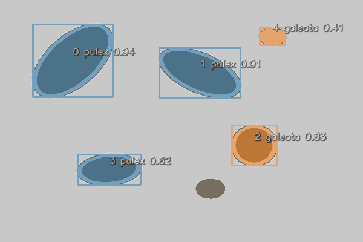
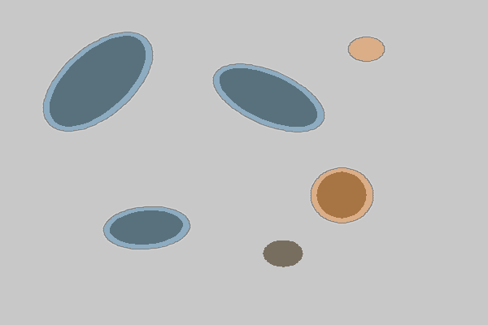
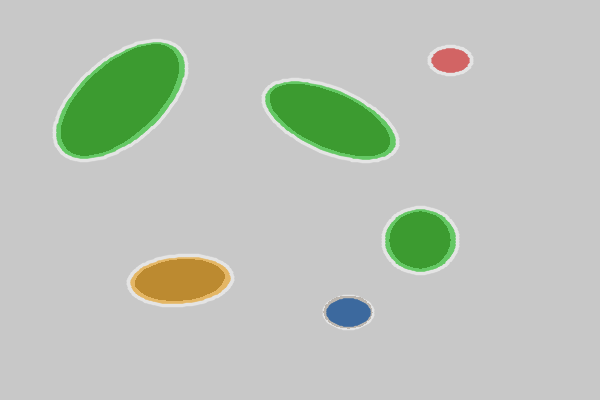
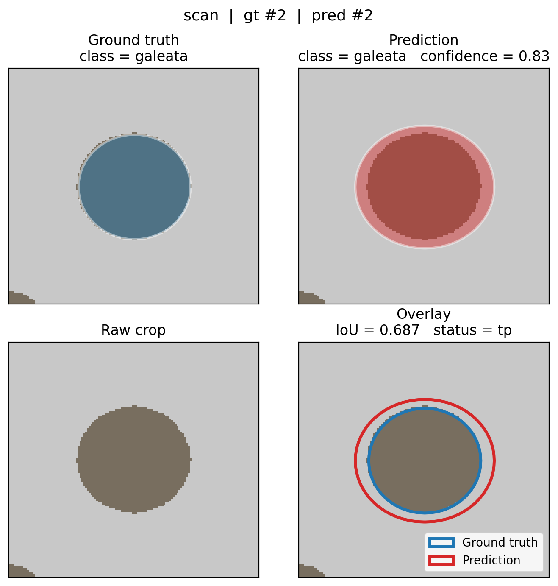
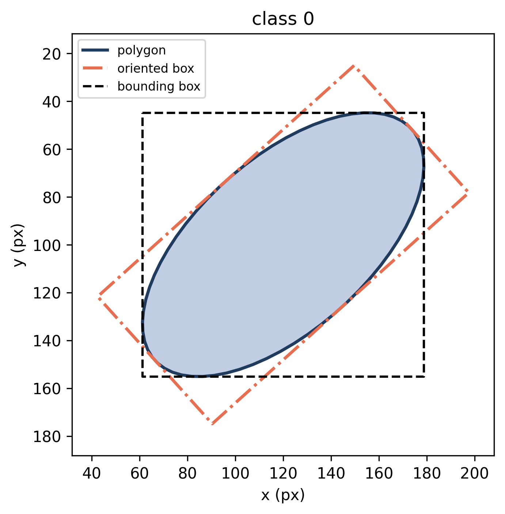
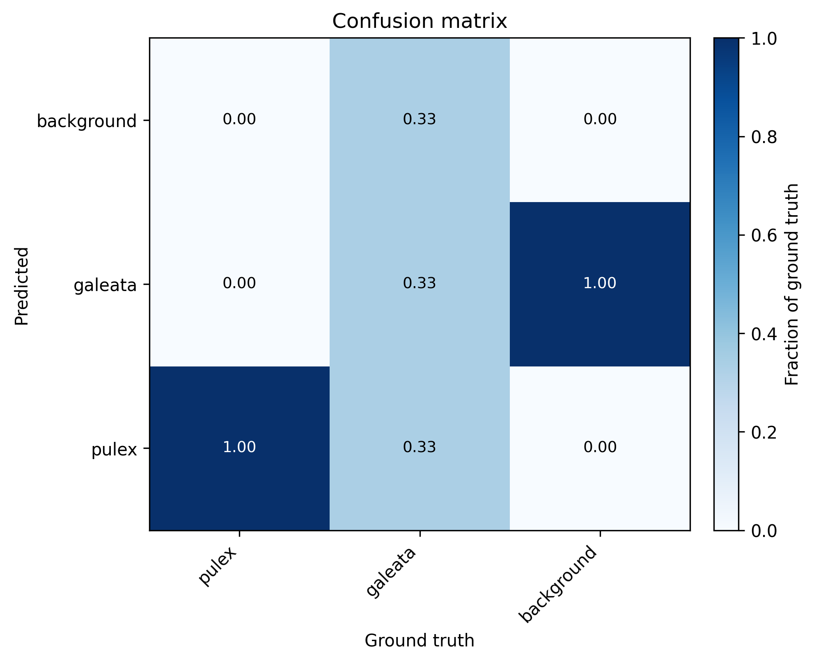
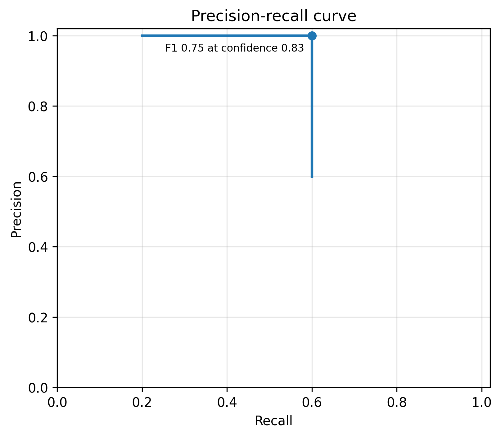
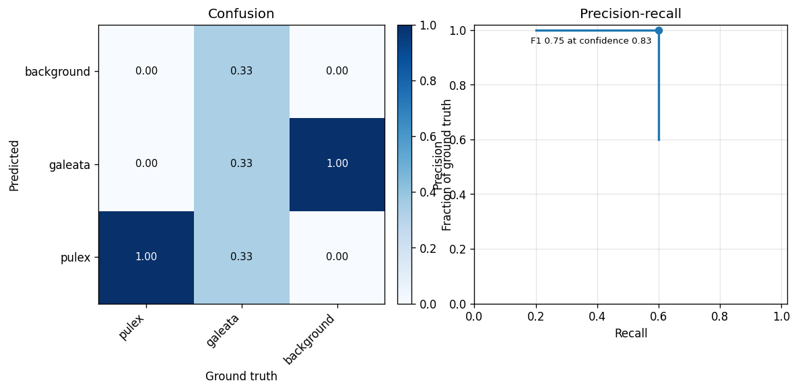

# Visualisation

[`hires.plot`](../reference/plot.md) draws annotations, match results and
evaluation charts. Two conventions hold throughout:

- Functions that draw **on an image** return an RGB `numpy.ndarray`.
- Functions that draw a **chart** return the Matplotlib `Axes` or `Figure`.

No function calls `plt.show()`, and every function accepts `save=` to write
the result to a file. Every figure on this page was produced by the code
shown above it.

## The example scan

To have something to draw, we make a small synthetic scan: a grey image
with five dark blobs, two of class 0 and three of class 1. With real data,
you would use the path of your scan and a collection from
[`hires.segment`][hires.segment] or [`hires.read_txt`][hires.read_txt].

```python
>>> import numpy as np
>>> import cv2
>>> from shapely.affinity import rotate, scale
>>> from shapely.geometry import Point
>>> import hires
>>> def blob(class_id, x, y, radius, stretch=1.0, angle=0.0):
...     outline = rotate(scale(Point(x, y).buffer(radius), yfact=stretch), angle)
...     return hires.Annotation(class_id, outline)
>>> gt = hires.Collection(
...     [
...         blob(0, 0.20, 0.25, 0.07, stretch=2.2, angle=30),
...         blob(0, 0.55, 0.30, 0.06, stretch=2.0, angle=-50),
...         blob(1, 0.70, 0.60, 0.05, stretch=1.4),
...         blob(1, 0.30, 0.70, 0.05, stretch=1.5, angle=80),
...         blob(1, 0.58, 0.78, 0.04),
...     ],
...     name="scan",
...     image_size=(600, 400),
... )
>>> scan = np.full((400, 600, 3), 200, dtype=np.uint8)
>>> for a in gt:
...     outline = np.array(a.to_pixels((600, 400)).exterior.coords, dtype=np.int32)
...     _ = cv2.fillPoly(scan, [outline], (95, 110, 120))
```

The "predictions" are the same outlines, grown a little, with one object
missing, one given the wrong class, and one spurious detection added:

```python
>>> def predicted(a, confidence, class_id=None):
...     return a.replace(
...         polygon=a.polygon.buffer(0.012),
...         confidence=confidence,
...         class_id=a.class_id if class_id is None else class_id,
...     )
>>> pred = hires.Collection(
...     [
...         predicted(gt[0], 0.94),
...         predicted(gt[1], 0.91),
...         predicted(gt[2], 0.83),
...         predicted(gt[3], 0.62, class_id=0),
...         blob(1, 0.75, 0.15, 0.035).replace(confidence=0.41),
...     ],
...     name="scan",
...     image_size=(600, 400),
... )
>>> names = {0: "pulex", 1: "galeata"}
```

## Annotations on an image

[`overlay`][hires.plot.overlay] fills each polygon in the colour of its
class, draws its bounding box and writes a label
`index class confidence` next to it:

```python
>>> rgb = hires.plot.overlay(scan, pred, class_names=names, save="plot_overlay.png")
>>> rgb.shape, rgb.dtype
((400, 600, 3), dtype('uint8'))
```



The **index** is the position of the annotation in the collection, and for
a collection read from disk, the line number in the label file. Use it to
look an object up:

```python
>>> pred[3]
Annotation(class_id=0, confidence=0.620, vertices=128)
```

Each element can be switched off:

```python
>>> _ = hires.plot.overlay(
...     scan, pred, boxes=False, labels=False, alpha=0.35, save="plot_outlines.png"
... )
```



The first argument is either the path of an image file or an 8-bit BGR
array, as returned by `hires.io.read_image`. Reading a large scan once and
passing the array avoids decoding it again for every figure. To show the
result in a notebook or a window, hand the returned array to Matplotlib:

```python
>>> import matplotlib.pyplot as plt
>>> image = plt.imshow(rgb)
```

Colours are taken from `hires.plot.PALETTE` by class id and repeat after
ten classes.

## Predictions versus ground truth

[`comparison`][hires.plot.comparison] colours each object by the outcome
of [matching](evaluation.md#matching):

```python
>>> matches = hires.metrics.match(gt, pred)
>>> matches.counts()
{'tp': 3, 'misclassified': 1, 'fp': 1, 'fn': 1}
>>> _ = hires.plot.comparison(scan, matches, save="plot_comparison.png")
```



| Colour | Status | Polygon drawn |
|--------|--------|---------------|
| Green | `tp` | Prediction |
| Orange | `misclassified` | Prediction |
| Red | `fp` | Prediction |
| Blue | `fn` | Missed ground truth |

For the result of matching two albums, select one image first with
`matches.for_image(name)`. [`hires.evaluate`][hires.evaluate] writes this
image for every scan.

## A single object

[`individual`][hires.plot.individual] crops the image around one match and
draws four panels: the ground-truth mask, the predicted mask, the raw crop,
and both outlines together with the IoU and the match status.

```python
>>> worst = matches.pick("tp", by="worst_iou")
>>> figure = hires.plot.individual(
...     worst, scan, class_names=names, figsize=(7, 7), save="plot_individual.png"
... )
```

{ width="520" }

When the collections were read with their images (`image=` or
`image_dir=`), the image argument can be left out and is taken from the
match. For many figures of one scan, read the scan once and pass the
array, as here.

!!! warning "Close figures in loops"

    Matplotlib keeps every figure alive until it is closed. When producing
    figures in a loop, call `plt.close(figure)` after saving:

    ```python
    >>> for number, m in enumerate(matches.with_status("fp", "fn")):
    ...     figure = hires.plot.individual(m, scan, save=f"errors/{number:03d}.png")
    ...     plt.close(figure)
    ```

To draw only the outline of one annotation, without an image, use
[`annotation`][hires.plot.annotation]. With `obb=True` it adds the minimum
rotated rectangle from which body length and width are measured, and with
`bbox=True` the axis-aligned bounding box:

```python
>>> ax = hires.plot.annotation(
...     gt[0], image_size=gt.image_size, obb=True, bbox=True, save="plot_annotation.png"
... )
```

{ width="360" }

## Evaluation charts

### Confusion matrix

```python
>>> matrix = hires.metrics.confusion_matrix(gt, pred, class_names=names)
>>> matrix
pred        pulex  galeata  background
gt
pulex           2        0           0
galeata         1        1           1
background      0        1           0
>>> ax = hires.plot.confusion_matrix(matrix, save="plot_confusion.png")
```

{ width="440" }

Each row is normalized to sum to one, so the diagonal reads as recall per
class. Pass `normalize=False` for raw counts.

### Precision-recall curves

```python
>>> curve = hires.metrics.precision_recall_curve(gt, pred)
>>> ax = hires.plot.precision_recall(curve, save="plot_pr.png")
```

{ width="440" }

The marker shows the point with the best F1. To compare several curves,
pass a dict of `{label: curve}`, for example one curve per class or one per
model:

```python
>>> curves = {
...     label: hires.metrics.precision_recall_curve(gt, pred, class_id=class_id)
...     for class_id, label in names.items()
... }
>>> ax = hires.plot.precision_recall(curves)
```

### Training curves

[`training_curves`][hires.plot.training_curves] plots the training and
validation losses from the `results.csv` that Ultralytics writes during
training. With `patience`, a vertical line marks the best epoch, assuming
training was ended by early stopping.

```python
>>> figure = hires.plot.training_curves(  # doctest: +SKIP
...     "runs/segment/train/results.csv", patience=50
... )
```

## Composing figures

Chart functions accept `ax=`, so they fit into any Matplotlib layout:

```python
>>> figure, (left, right) = plt.subplots(1, 2, figsize=(11, 4.5))
>>> _ = hires.plot.confusion_matrix(matrix, ax=left, title="Confusion")
>>> _ = hires.plot.precision_recall(curve, ax=right, title="Precision-recall")
>>> figure.savefig("plot_composed.png", dpi=120, bbox_inches="tight")
```



## Working without a display

On a server or in a batch job, select a non-interactive Matplotlib backend
before the first plot:

```python
>>> import matplotlib
>>> matplotlib.use("Agg")
```

The `hires` command needs no such setup.

## See also

- Reference: [`hires.plot`](../reference/plot.md)
- [Evaluation](evaluation.md)
