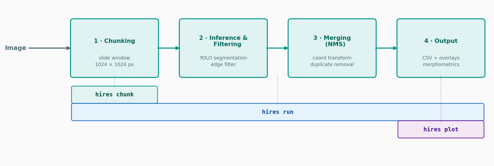

# Tiled segmentation

High-resolution scans routinely exceed 10,000 × 10,000 pixels. Passing such
an image to a segmentation network in one piece is impossible on ordinary
hardware, and downscaling it destroys the small objects one wants to
measure. HiReS therefore processes the image **tile by tile** at full
resolution and reassembles the result.

This page describes the algorithm and how to choose its parameters. The
entry points are

| Function | Use it to |
|----------|-----------|
| [`hires.segment`][hires.segment] | Segment one image in one call |
| [`hires.Segmenter`][hires.Segmenter] | Segment many images with one loaded model |
| [`hires.run_pipeline`][hires.run_pipeline] | Segment files and write all outputs to disk |

## Overview



1. **Tile.** Cut the image into overlapping tiles.
2. **Predict.** Run the model on every tile.
3. **Filter edges.** Discard detections that touch a tile border.
4. **Merge.** Transform the remaining polygons to full-image coordinates.
5. **Deduplicate.** Remove duplicates from overlapping tiles with polygon
   non-maximum suppression (NMS).

The result is a [`Collection`][hires.Collection] in full-image normalized
coordinates, ordered by decreasing confidence.

## 1. Tiling

Tiles of size $T$ are placed every $T - o$ pixels along each axis, where $o$
is the overlap, starting at the origin and continuing until the image is
covered. An axis of length $L > T$ therefore receives

$$
n = 1 + \left\lceil \frac{L - T}{T - o} \right\rceil
$$

tiles, and an axis with $L \le T$ exactly one. A tile is identified by the
pixel coordinates $(x_0, y_0)$ of its top-left corner.

```python
>>> import hires
>>> hires.tiling.tile_grid((2500, 900), tile_size=1024, overlap=150)
[(0, 0), (874, 0), (1748, 0)]
```

The last tile along an axis usually extends past the image border. The part
outside the image is filled with zeros (black), so that every tile has the
same size.

## 2. Prediction

Tiles are passed to the model in batches of `batch_size`. Each tile is
resized by the model to `inference_size` (the Ultralytics `imgsz`), and
detections below `confidence` are dropped by the model itself. Each
detection becomes an [`Annotation`][hires.Annotation] whose polygon is
normalized **to the tile**.

## 3. Edge filtering

An object that crosses a tile border is seen only partially by that tile,
and the model returns a truncated polygon for it. Measuring such a fragment
would be wrong. HiReS discards every detection that is not fully contained
in the tile shrunk by a margin $m$ on every side:

$$
\text{keep} \iff \text{polygon} \subseteq [m,\, 1 - m] \times [m,\, 1 - m]
$$

in tile-normalized coordinates, with $m$ = `edge_margin` (default 0.01, i.e.
about 10 px of a 1024 px tile). This is what
[`Annotation.within_frame`][hires.Annotation.within_frame] tests.

Discarding is safe **because of the overlap**: an object dropped from one
tile lies fully inside the neighbouring tile, provided it is small enough
(see [Choosing the overlap](#choosing-the-overlap)).

## 4. Merging

A point $(x, y)$ normalized to a tile of size $(T_w, T_h)$ with corner
$(x_0, y_0)$ maps to the full image of size $(W, H)$ as

$$
x' = \frac{x \, T_w + x_0}{W}, \qquad y' = \frac{y \, T_h + y_0}{H}.
$$

After merging, the edge filter is applied once more, now to the **full
image**, which removes objects cut by the border of the scan itself and
detections in the zero-padded area.

!!! note "The margin is relative"
    `edge_margin` is a fraction of the tile in step 3 and a fraction of the
    full image here. With the default of 0.01, objects within 1 % of the
    image width or height of the scan border are excluded. Set
    `edge_margin=0` to keep everything, at the price of keeping fragments.

## 5. Non-maximum suppression

An object inside the overlap region is detected, in full, by two or more
tiles. These duplicates are removed by
[`Collection.nms`][hires.Collection.nms]:

1. Sort the annotations by decreasing confidence; ties are broken in favour
   of the larger polygon.
2. Take the first remaining annotation and keep it.
3. Remove every remaining annotation whose polygon IoU with it exceeds
   `nms_iou`.
4. Repeat from 2.

The intersection-over-union is computed on the **polygons**, not on their
bounding boxes,

$$
\operatorname{IoU}(A, B) = \frac{|A \cap B|}{|A \cup B|},
$$

and candidate pairs are found with a spatial index (an STR-tree), so the
cost grows with the number of overlapping pairs rather than with the square
of the number of detections.

In the pipeline NMS is class-agnostic: two detections of the same object
with different classes count as duplicates, and the more confident one wins.

## Choosing the parameters

### Choosing the overlap

Along one axis, consecutive tiles keep the detections inside windows that
overlap by $o - 2mT$ pixels. An object whose extent along that axis is
smaller than this is therefore always fully inside at least one tile:

$$
d_{\max} < o - 2\,m\,T
$$

With the defaults ($o = 150$, $m = 0.01$, $T = 1024$) objects up to about
**130 px** are guaranteed to be captured. Larger objects that happen to
straddle a tile border are lost.

!!! tip "Rule of thumb"
    Set `overlap` to slightly more than the largest object you expect, in
    pixels. If large objects go missing in a regular grid pattern, the
    overlap is too small.

A larger overlap means more tiles and proportionally more inference time.

### Tile size and inference size

`tile_size` is the size of the cut-out in the original image;
`inference_size` is the size the model sees. Keep them equal to the tile
size the model was trained on, so that objects appear at the scale the model
learned. Setting `tile_size` larger than `inference_size` downsamples each
tile: faster, but small objects lose detail.

### Confidence

A lower `confidence` finds more objects and more false positives. If you
have ground truth, choose the threshold from the precision-recall curve
rather than by eye; see
[Evaluation](evaluation.md#choosing-a-confidence-threshold). To do so, run
the model once with a low threshold and filter afterwards with
[`filter_confidence`][hires.Collection.filter_confidence].

### NMS threshold

`nms_iou` (default 0.7) must be low enough to merge two detections of the
same object from different tiles, which typically overlap almost perfectly,
and high enough not to remove a genuinely different object that overlaps
its neighbour. Lower it if you see doubled outlines; raise it if touching
individuals disappear.

### Summary

| Parameter | Default | Raise it when | Lower it when |
|-----------|---------|---------------|---------------|
| `tile_size` | 1024 | — | Out of memory during inference |
| `overlap` | 150 | Large objects are missed at tile borders | Runs are too slow |
| `confidence` | 0.5 | Too many false positives | Objects are missed |
| `inference_size` | 1024 | Small objects are missed | Out of memory, or too slow |
| `edge_margin` | 0.01 | Truncated fragments survive | Objects near borders are missed |
| `nms_iou` | 0.7 | Touching objects are suppressed | Duplicates survive |
| `batch_size` | 8 | A GPU is under-used | Out of memory |

## Reusing a model

[`hires.segment`][hires.segment] loads the model on every call. For more
than one image, create a [`Segmenter`][hires.Segmenter] once:

```python
segmenter = hires.Segmenter("DaphnAI.pt", overlap=300, device="0")

for path in hires.io.find_images("scans/"):
    collection = segmenter.segment(path)
    collection.to_txt(f"results/{path.stem}.txt")
```

`segmenter.class_names` returns the `{class_id: label}` mapping stored in the
model, and `segmenter.parameters()` the settings as a plain dict.

### Arrays as input

`segment` also accepts an 8-bit BGR array of shape `(height, width, 3)`:

```python
pixels = hires.io.read_image("scan.tif")
collection = segmenter.segment(pixels, name="scan")
```

### Using another model

The `model` argument may be an already loaded object instead of a path. Any
object works that provides

- `predict(tiles, conf=..., imgsz=..., device=..., verbose=False)`, returning
  one result per tile with `masks.xyn` (tile-normalized polygons),
  `boxes.cls` and `boxes.conf`, and
- optionally `names`, a list or dict of class labels.

This is the interface of `ultralytics.YOLO`. Passing an object does not
require the `yolo` extra.

## A worked example without a neural network

The interface above is small enough to write a toy "model" by hand, which
makes the whole pipeline runnable in a few lines and shows what the
parameters do. This one outlines every bright blob in a tile:

```python
>>> from types import SimpleNamespace
>>> import numpy as np
>>> import cv2
>>> class BlobModel:
...     names = {0: "blob"}
...     def predict(self, tiles, conf, imgsz, device, verbose):
...         results = []
...         for tile in tiles:
...             height, width = tile.shape[:2]
...             mask = (tile[..., 0] > 128).astype(np.uint8)
...             contours, _ = cv2.findContours(
...                 mask, cv2.RETR_EXTERNAL, cv2.CHAIN_APPROX_SIMPLE
...             )
...             polygons = [c.reshape(-1, 2) / (width, height) for c in contours]
...             boxes = SimpleNamespace(
...                 cls=np.zeros(len(polygons)), conf=np.full(len(polygons), 0.9)
...             )
...             masks = SimpleNamespace(xyn=polygons) if polygons else None
...             results.append(SimpleNamespace(masks=masks, boxes=boxes))
...         return results
```

The scan is a black 600 × 400 px image with three white squares of 40 px:

```python
>>> scan = np.zeros((400, 600, 3), dtype=np.uint8)
>>> for x, y in [(50, 50), (240, 100), (450, 300)]:
...     scan[y : y + 40, x : x + 40] = 255
```

With 256 px tiles and an overlap of 64 px, the image is covered by six
tiles, and all three squares are found exactly once:

```python
>>> import hires
>>> hires.tiling.tile_grid((600, 400), tile_size=256, overlap=64)
[(0, 0), (0, 192), (192, 0), (192, 192), (384, 0), (384, 192)]
>>> found = hires.segment(scan, BlobModel(), tile_size=256, overlap=64)
>>> found
Collection(name=None, n=3, image_size=(600, 400))
>>> sorted(tuple(round(v) for v in a.to_pixels((600, 400)).bounds) for a in found)
[(50, 50, 89, 89), (240, 100, 279, 139), (450, 300, 489, 339)]
```

The second square spans x = 240…280 and therefore crosses the right border
of the first tile (x = 256). That tile sees only a fragment and discards
it; the neighbouring tile, which starts at x = 192, sees the square in
full.

Now remove the overlap. The tile border at x = 256 still cuts the square,
but no other tile contains it completely, and it is lost:

```python
>>> len(hires.segment(scan, BlobModel(), tile_size=256, overlap=0))
2
```

Switching the edge filter off instead keeps the square, but as two
separate fragments, which are the two small areas below:

```python
>>> halves = hires.segment(scan, BlobModel(), tile_size=256, overlap=0, edge_margin=0)
>>> len(halves)
4
>>> sorted(int(a.to_pixels((600, 400)).area) for a in halves)
[585, 897, 1520, 1521]
```

Neither is what you want, which is why the overlap must exceed the size of
the largest object.

A [`Segmenter`][hires.Segmenter] holds the model and the settings, and is
the object to reuse across images:

```python
>>> segmenter = hires.Segmenter(BlobModel(), tile_size=256, overlap=64)
>>> segmenter.class_names
{0: 'blob'}
>>> segmenter.parameters()["overlap"], segmenter.parameters()["nms_iou"]
(64, 0.7)
>>> segmenter.segment(scan, name="again")
Collection(name='again', n=3, image_size=(600, 400))
```

## Memory

The image is decoded completely into memory as an 8-bit, three-channel
array, which takes $3\,W H$ bytes (about 300 MB for a 10,000 × 10,000 px
scan). Tiles are views into that array, so tiling itself costs almost
nothing. Inference memory is governed by `inference_size` and `batch_size`,
not by the size of the scan.

## Debugging

To see what happens at each stage, pass `debug_dir` to
[`Segmenter.segment`][hires.Segmenter.segment] (or `debug=True` to
`run_pipeline`, or `--debug` on the command line):

```python
segmenter.segment("scan.tif", debug_dir="debug/")
```

| Path | Content |
|------|---------|
| `tiles/{name}_{x}_{y}.png` | Every tile |
| `tile_labels/{name}_{x}_{y}.txt` | Raw predictions of the tile, before edge filtering |
| `tile_overlays/{name}_{x}_{y}.png` | Raw predictions drawn on the tile |
| `{name}_merged.txt` | Edge-filtered detections in full-image coordinates, before NMS |

Compare a tile overlay with the final result to tell whether an object was
missed by the model, removed by the edge filter, or suppressed by NMS.

## See also

- Reference: [Segmentation](../reference/segmentation.md),
  [`hires.tiling`](../reference/tiling.md)
- [Output files](../reference/outputs.md)
